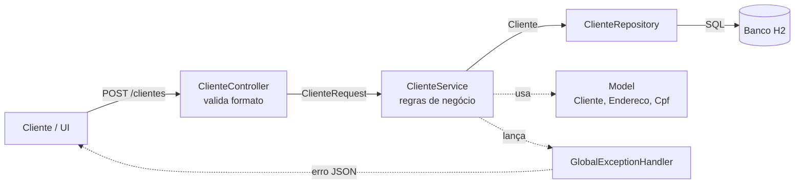
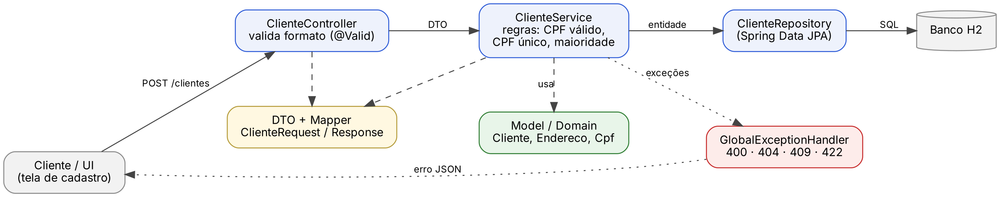

# Hotel Reserva — Sistema de Reservas para Hotel

Projeto da disciplina de Engenharia de Software (Uniube).
Funcionalidade implementada nesta etapa: **US02 — Cadastrar cliente**

> Como **recepcionista**, quero **cadastrar clientes**, para poder criar reservas de quartos.

## Arquitetura em camadas

O código separa responsabilidades em camadas. Cada camada só conversa com a camada logo abaixo dela:





| Camada | Pasta | Responsabilidade | O que evita |
|---|---|---|---|
| Controller | `controller/` | Receber a requisição HTTP, validar o **formato** (`@Valid`) e devolver a resposta | Regra de negócio |
| Service | `service/` | Orquestrar o caso de uso e aplicar as **regras**: CPF válido, CPF único, titular maior de idade | Detalhes de HTTP/tela |
| Repository | `repository/` | Acesso a dados (Spring Data JPA) | Regra de negócio |
| Model | `model/` | Conceitos do domínio (`Cliente`, `Endereco`, `Cpf`) e regras que dependem só deles | Conhecer UI ou banco |
| DTO + Mapper | `dto/`, `mapper/` | Contratos de entrada/saída e conversão para a entidade (o CPF sai mascarado) | Expor a entidade direto na API |
| Exceções | `exception/` | Erros de negócio e tradução para HTTP (400, 404, 409, 422) | `try/catch` espalhado no Controller |

### Fluxo do cadastro

`POST /clientes` → **Controller** valida formato → **Service** valida CPF, verifica duplicidade e idade → **Repository** salva → resposta `201 Created` com o DTO.

## Endpoints

| Método | Rota | Descrição | Respostas |
|---|---|---|---|
| POST | `/clientes` | Cadastra um cliente | 201, 400 (formato), 409 (CPF duplicado), 422 (CPF inválido / menor de idade) |
| GET | `/clientes/{id}` | Busca um cliente | 200, 404 |
| GET | `/clientes?nome=ana` | Busca por nome | 200 |

Exemplo:

```bash
curl -X POST http://localhost:8080/clientes \
  -H "Content-Type: application/json" \
  -d '{"nome":"Ana Souza","cpf":"529.982.247-25","dataNascimento":"1995-05-10",
       "telefone":"(34) 99999-0001","email":"ana@email.com",
       "endereco":{"cep":"38400-000","logradouro":"Av. Rondon Pacheco","numero":"100","cidade":"Uberlândia","uf":"MG"}}'
```

## Como executar

Requisitos: Java 17+ e Maven.

```bash
mvn spring-boot:run   # sobe em http://localhost:8080
mvn test              # roda os testes
```

Console do banco H2: http://localhost:8080/h2-console (JDBC URL `jdbc:h2:mem:hotel`, usuário `sa`).

## Testes

- `CpfTest` — regra de dígitos verificadores (domínio puro).
- `ClienteServiceTest` — regras de negócio com o repositório simulado (Mockito), sem banco e sem HTTP.
- `ClienteControllerTest` — só a borda HTTP (`@WebMvcTest`): status 201/400/409 e JSON de resposta.

Separar as camadas é o que permite testar cada parte isoladamente.
